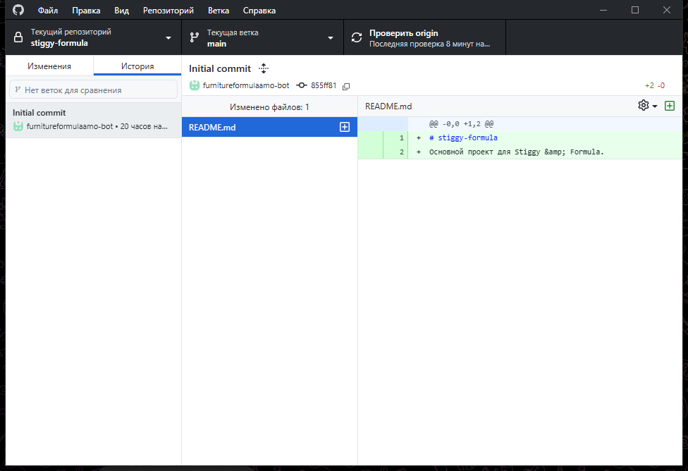

# Русификатор GitHub Desktop для Windows

Неофициальная русская локализация GitHub Desktop с безопасной установкой и полным откатом.



## Поддерживаемая версия

- GitHub Desktop **3.6.10** и **3.6.11**;
- Windows 10/11;
- версия русификатора **1.4.8** (один словарь для обеих сборок).

Установщик сам выбирает установленную сборку. Если на компьютере есть обе, правится более новая. SHA-256 сверяется с эталоном выбранной сборки. Другая версия GitHub Desktop или изменённые файлы установку останавливают.

## Быстрая установка

1. Скачайте архив из раздела [Releases](https://github.com/kiruxa555/github-desktop-russian-patch/releases/latest).
2. Распакуйте архив в отдельную папку.
3. Запустите `Установить.cmd`.
4. Дождитесь автоматического перезапуска GitHub Desktop.

Node.js, Git и права администратора для установки не нужны.

## Возврат английского интерфейса

Запустите `Вернуть-английский.cmd`. Скрипт восстановит исходные файлы из резервной копии и снова откроет GitHub Desktop.

## Что делает установщик

- закрывает GitHub Desktop;
- проверяет совместимость установленной версии;
- сохраняет резервную копию `main.js` и `renderer.js`;
- выполняет только заранее проверенные точечные замены;
- сверяет SHA-256 полученных файлов;
- запускает приложение заново.

Русификатор не изменяет репозитории, учётные записи, пароли, настройки Git и файлы проектов.

## Что не переводится

Имена репозиториев, веток и файлов, а также тексты коммитов остаются без изменений. Например, `Initial commit` в истории — это данные репозитория, а не надпись интерфейса.

## Ручной запуск

Проверка без изменения приложения:

```powershell
powershell.exe -NoProfile -ExecutionPolicy Bypass -File .\Install-Russian.ps1 -DryRun -NoLaunch
```

Установка:

```powershell
powershell.exe -NoProfile -ExecutionPolicy Bypass -File .\Install-Russian.ps1
```

Откат:

```powershell
powershell.exe -NoProfile -ExecutionPolicy Bypass -File .\Uninstall-Russian.ps1
```

## Разработка

Словарь и точечные замены находятся в [`src/ru-map.cjs`](src/ru-map.cjs). Скрипт [`src/patch.cjs`](src/patch.cjs) применяет их к локальной копии файлов поддерживаемой версии GitHub Desktop. Готовый `patch-manifest.json` используется автономным PowerShell-установщиком.

Проверка синтаксиса:

```powershell
node --check .\src\ru-map.cjs
node --check .\src\patch.cjs
node --check .\src\build-manifest.cjs
```

Результаты проверки версии 1.4.8 приведены в [`docs/VERIFICATION.md`](docs/VERIFICATION.md).

## Важно

После обновления GitHub Desktop потребуется новая совместимая версия русификатора. Не пытайтесь вручную применять старый манифест к новой версии приложения.

Проект не связан с GitHub, Inc. GitHub и GitHub Desktop являются товарными знаками их владельцев.

## Лицензия

[MIT](LICENSE). Сведения о сторонних материалах находятся в [`docs/THIRD-PARTY-NOTICES.md`](docs/THIRD-PARTY-NOTICES.md).
